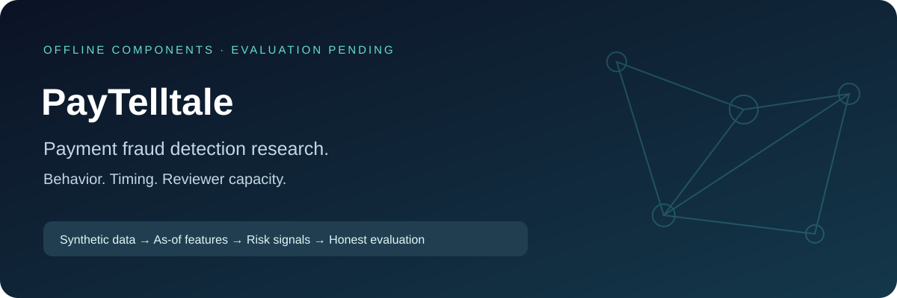
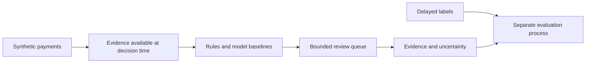

<p align="center"></p>

# Transaction Fraud Lab

[](https://github.com/vishwanathmuthuraman/Transaction-Fraud-Lab/actions/workflows/docs.yml)
[](https://github.com/vishwanathmuthuraman/Transaction-Fraud-Lab/actions/workflows/implementation.yml)

**An evidence-first research plan for ranking suspicious payments under delayed feedback and limited reviewer capacity.**

A payment may look unusual and still be legitimate. This project asks whether a model can find more simulated fraudulent payments without overwhelming reviewers or treating ordinary customer behavior as wrongdoing.

| Status | Evidence available today |
| --- | --- |
| Design | Requirements, architecture, public milestones and evaluation protocol |
| Examples | Original synthetic cases and expected behavior specifications |
| Validation | 36 executed component/CLI tests plus separate documentation integrity checks |
| Implementation | Initial payment features, label-eligibility helper and offline bounded queue; trained model and benchmark pending |
| Distribution | Curated public research specification; license selection pending |

## Run the initial implementation

Install [uv](https://docs.astral.sh/uv/getting-started/installation/), then run these commands from this repository. The runtime is pinned to Python 3.12.13; dependencies are pinned in `uv.lock`.

```sh
uv sync --locked
uv run --locked fraud-lab features examples/ordinary-history.case.json
uv run --locked pytest
```

The CLI prints JSON. `validate` checks the same input contract; invalid or unsupported input returns exit code 2 with a JSON error on stderr. Successful inspection returns exit code 0.

**Verified locally:** 36 behavioral/CLI tests, Ruff checks, and an installed wheel executed outside the checkout. See [completed tasks and next steps](docs/IMPLEMENTATION.md), [the actual verification record](reports/initial-implementation/verification.json) and [captured demo output](reports/initial-implementation/demo-1.json). This evidence covers the initial offline components; the full study remains pending.

## The research question

Can **time-correct behavioral and local transaction-graph features** improve fraud recall at a fixed review capacity, when feedback arrives late and payment behavior changes? Compare them against transparent rules, logistic regression and a tabular tree model, including hard legitimate cases and unseen entities.

This is a proposed experiment, not an established new algorithm. A carefully measured negative answer remains useful.



## What makes the work worth inspecting

- **No time travel:** future transactions, late labels and future graph edges cannot improve historical predictions.
- **Operational metrics:** recall and precision at a fixed review budget, false alerts, calibration and modeled cost; accuracy alone does not pass.
- **Hard negatives:** payroll bursts, first-time customers and shared merchants must challenge simplistic fraud rules.
- **Honest evidence:** each flagged payment carries the observations used, their timestamps and reasons to doubt the finding.
- **Reproducibility:** frozen splits, generator settings, seeds, hashes, model versions and actual run manifests.

## Start here

[Reading guide](START-HERE.md) · [Engineering policy](ENGINEERING.md) · [Requirements](docs/01-product-requirements.md) · [Public milestones](docs/03-build-plan.md) · [Evaluation](docs/04-evaluation.md)

Initial Python feature and queue components are implemented. The complete training/evaluation pipeline remains planned. Rust is an optional future inference component only if measurements justify it. There is no live-payment integration, autonomous payment blocking or allegation generation.

## Run the documentation checks

These commands validate this blueprint; they do not train or test a fraud model.

```sh
uv sync --locked
uv run --locked python scripts/validate_blueprint.py
uv run --locked python scripts/check_public_docs.py
```

See [source rationale](docs/06-sources-and-design-rationale.md) for the primary research and institutional reports that informed the plan. They do not endorse this project. See [publication boundary](docs/08-publication.md) before making any files public.

## Public package

This edition includes original synthetic examples, contracts, evaluation methods, source rationale and public milestones. Internal task schedules and effort estimates are maintained outside the repository. Initial component source and verification are included; trained algorithm results remain pending. License selection is pending; no code, documentation or data license grant is supplied.

Maintained by [Vishwanath Muthuraman](https://github.com/vishwanathmuthuraman). [Contribution guidance](CONTRIBUTING.md) explains how to propose a synthetic case or challenge a design assumption.
